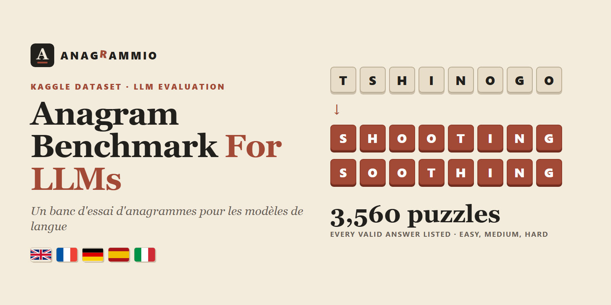

# Anagram Benchmark For LLMs In 5 Languages



**English first, version française complète plus bas. Kurzfassung auf Deutsch, resumen en español e sintesi in italiano at the end.**

## A Multilingual Anagram Benchmark For Language Models

TSHINOGO gives SHOOTING and SOOTHING. EOTATNNTI gives ATTENTION and TENTATION. TRPTSIOE gives POTRESTI, PRESTITO, PROTESTI, RISPETTO and STREPITO.

Language models read tokens, not letters, and rearranging letters is one of the tasks they still get wrong. This dataset gives **3,560 anagram puzzles** in 🇬🇧 English, 🇫🇷 French, 🇩🇪 German, 🇪🇸 Spanish and 🇮🇹 Italian. Each puzzle is a set of scrambled letters, and every puzzle has **at least two valid answers**, all listed and checked against a curated dictionary. A model has to find a real word, and a strong model should find all of them.

The puzzles come from [Anagrammio](https://www.anagrammio.com), a free anagram solver in five languages. Each puzzle is built from a family of everyday words, so the answers are words people know, and every row links to the word's page on the site.

### What Is In The File

| | |
|---|---|
| Puzzles | 3,560 |
| Languages | `en` 534, `fr` 760, `de` 642, `es` 825, `it` 799 |
| Length | 4 to 14 letters |
| Difficulty | `easy` 1,381 (4 to 5 letters), `medium` 1,600 (6 to 7), `hard` 579 (8 and more) |
| Answers per puzzle | 2 to 19, median 3 |
| Split | `train` 3,176 and `test` 384, stable across versions |

A few puzzles from the file.

| language | scrambled | answers | difficulty |
|---|---|---|---|
| en | TSHINOGO | shooting, soothing | hard |
| en | SROTONCINVAE | conservation, conversation | hard |
| fr | TMRSEUEN | menstrue, menteurs, mesurent, musèrent, résument, sûrement | hard |
| de | EWCSRTSEH | schwerste, Schwertes, Schwester | hard |
| es | NETIES | siente, tenéis, tienes | medium |
| it | TRPTSIOE | potresti, prestito, protesti, rispetto, strepito | hard |

### How The Puzzles Are Built

Each puzzle starts from a family of anagrams whose words all rank among the 20,000 most frequent words of the language. The letters are shuffled with a fixed seed until they spell none of the answers. The `answers` column then lists **every common word** of the dictionary written with those letters, not only the frequent ones, so a correct rarer answer is not marked wrong.

Accents are ignored when matching, so `écart` matches the letters of `trace`. German keeps **ä, ö and ü** as letters of their own and writes **ß** as `ss`. Spanish keeps **ñ**. Answers keep their usual spelling, accents and German capitals.

### Columns

| column | description |
|---|---|
| `puzzle_id` | Stable puzzle identifier, such as `it-2851` |
| `language` | `en`, `fr`, `de`, `es` or `it` |
| `scrambled` | The shuffled letters, in capitals, accents removed (ä, ö, ü, ñ kept) |
| `length` | Number of letters |
| `answers` | Every valid answer, separated by `\|` |
| `n_answers` | Number of valid answers |
| `difficulty` | `easy`, `medium` or `hard`, by length |
| `best_frequency_rank` | Frequency rank of the most common answer (1 is the most frequent word) |
| `split` | `train` or `test` |
| `url` | Page of the most common answer on anagrammio.com |

### How To Score A Model

- **Find one.** Ask for one word using all the letters. Count it right if it is in `answers`, ignoring case and accents.
- **Find all.** Ask for every word. Report recall, the share of `answers` found, and precision, the share of proposed words that are valid.
- **Check the letters.** Many wrong answers are real words that use the wrong letters. Comparing sorted letters catches them.

Report results per language and per `difficulty`. Hard puzzles are where models fall apart.

### Limitations

Difficulty comes from length only. Some short puzzles are hard and some long ones easy. The dictionary covers common vocabulary, so a few valid but very rare words can be missing from `answers`. Inflected forms count, which gives French and Spanish more verb answers.

### License And Citation

**CC BY-SA 4.0**, because the word lists derive from Wiktionary. Use it, share it and adapt it, commercially or not, under the same license, and credit **Anagrammio** with a link to **[anagrammio.com](https://www.anagrammio.com)**.

```bibtex
@misc{anagrammio_anagram_benchmark_2026,
  title  = {A multilingual anagram benchmark for language models},
  author = {{Anagrammio}},
  year   = {2026},
  url    = {https://www.anagrammio.com},
  note   = {Hugging Face dataset}
}
```

Sources. Word lists from Wiktionary through kaikki.org (CC BY-SA), with hbenbel French-Dictionary and other open French word lists (MIT) for French, SCOWL for English, Morph-it! (CC BY-SA 2.0) for Italian and doozan spanish_data (CC BY 4.0) for Spanish. Word frequencies from FrequencyWords by Hermit Dave, built on OpenSubtitles 2018 (CC BY-SA).

Companion datasets, **[Common Anagram Families | 5 Languages](https://huggingface.co/datasets/anagrammio/common-anagram-families)** and **[Anagram Statistics | 5 Languages](https://huggingface.co/datasets/anagrammio/anagram-statistics)**.

Also on Kaggle, **[Anagram Benchmark For LLMs | 5 Languages](https://www.kaggle.com/datasets/cuivrax/anagram-benchmark-llm-5-languages)**, with a starter notebook.

---

## Version Française

### Un Banc D'Essai D'Anagrammes Multilingue Pour Les Modèles De Langue

EOTATNNTI donne ATTENTION et TENTATION. TMRSEUEN donne MENTEURS, MESURENT, RÉSUMENT et SÛREMENT.

Les modèles de langue lisent des morceaux de mots, pas des lettres, et remettre des lettres dans l'ordre fait partie de ce qu'ils ratent encore. Ce jeu de données propose **3 560 énigmes d'anagrammes** en anglais, français, allemand, espagnol et italien. Chaque énigme est une suite de lettres mélangées, avec **au moins deux bonnes réponses**, toutes listées et vérifiées dans un dictionnaire soigné. Un modèle doit trouver un vrai mot, et un bon modèle doit tous les trouver.

Les énigmes viennent d'[Anagrammio](https://www.anagrammio.com), un anagrammeur gratuit en cinq langues. Chacune part d'une famille de mots courants, les réponses sont donc des mots que tout le monde connaît, et chaque ligne renvoie à la page du mot sur le site.

### Contenu Du Fichier

| | |
|---|---|
| Énigmes | 3 560 |
| Langues | `en` 534, `fr` 760, `de` 642, `es` 825, `it` 799 |
| Longueur | 4 à 14 lettres |
| Difficulté | `easy` 1 381 (4 à 5 lettres), `medium` 1 600 (6 à 7), `hard` 579 (8 et plus) |
| Réponses par énigme | 2 à 19, médiane 3 |
| Découpage | `train` 3 176 et `test` 384, stable d'une version à l'autre |

### Comment Les Énigmes Sont Construites

Chaque énigme part d'une famille dont tous les mots sont dans les 20 000 plus fréquents de la langue. Les lettres sont mélangées avec une graine fixe jusqu'à ne plus former aucune réponse. La colonne `answers` liste ensuite **tous les mots courants** du dictionnaire écrits avec ces lettres, pas seulement les plus fréquents, pour qu'une bonne réponse plus rare ne soit pas comptée fausse.

Les accents sont ignorés pour la comparaison. L'allemand garde **ä, ö et ü** comme des lettres à part et écrit **ß** en `ss`. L'espagnol garde le **ñ**. Les réponses gardent leur orthographe, leurs accents et les majuscules allemandes.

### Comment Évaluer Un Modèle

- **En trouver une.** On demande un mot qui utilise toutes les lettres. La réponse est juste si elle figure dans `answers`, sans tenir compte des majuscules ni des accents.
- **Les trouver toutes.** On demande tous les mots, puis on mesure le rappel (la part de `answers` trouvée) et la précision (la part des mots proposés qui sont valides).
- **Vérifier les lettres.** Beaucoup de mauvaises réponses sont de vrais mots, mais avec les mauvaises lettres. Comparer les lettres triées suffit à les repérer.

Donnez les résultats par langue et par `difficulty`. C'est sur les énigmes difficiles que les modèles décrochent.

### Limites

La difficulté ne dépend que de la longueur. Le dictionnaire couvre le vocabulaire courant, quelques mots valides mais très rares peuvent donc manquer dans `answers`. Les formes conjuguées comptent, d'où davantage de verbes en français et en espagnol.

### Licence Et Citation

**CC BY-SA 4.0**, car les listes de mots dérivent du Wiktionnaire. Vous pouvez utiliser, partager et adapter ces données, y compris pour un usage commercial, sous la même licence, en citant **Anagrammio** avec un lien vers **[anagrammio.com](https://www.anagrammio.com)**.

---

### 🇩🇪 Kurzfassung

3.560 Anagramm-Rätsel in fünf Sprachen, jedes mit mindestens zwei geprüften Lösungen, etwa EWCSRTSEH für SCHWESTER, SCHWERTES und SCHWERSTE. Gedacht zum Testen von Sprachmodellen, mit festen Train- und Test-Teilen. Quelle [Anagrammio](https://www.anagrammio.com/de/), Lizenz CC BY-SA 4.0.

### 🇪🇸 Resumen

3.560 acertijos de anagramas en cinco idiomas, cada uno con al menos dos respuestas verificadas, como NETIES para TIENES, SIENTE y TENÉIS. Pensado para evaluar modelos de lenguaje, con partes train y test fijas. Fuente [Anagrammio](https://www.anagrammio.com/es/), licencia CC BY-SA 4.0.

### 🇮🇹 Sintesi

3.560 enigmi di anagrammi in cinque lingue, ognuno con almeno due soluzioni verificate, come TRPTSIOE per RISPETTO, PRESTITO e POTRESTI. Pensato per valutare i modelli linguistici, con parti train e test fisse. Fonte [Anagrammio](https://www.anagrammio.com/it/), licenza CC BY-SA 4.0.


---

**Part of [Verbarium](https://github.com/verbarium)**, open word data for word games and language tools. Data by [Anagrammio](https://www.anagrammio.com/). Also on [Kaggle](https://www.kaggle.com/datasets/cuivrax/anagram-benchmark-llm-5-languages) and [Hugging Face](https://huggingface.co/datasets/anagrammio/anagram-benchmark-llm).
